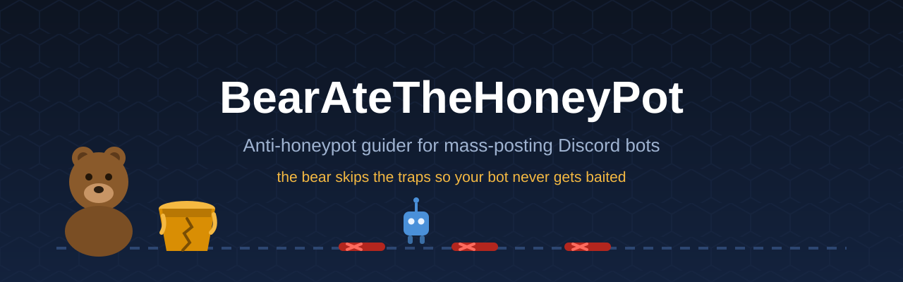

# 🐻 BearAteTheHoneyPot



**The anti-honeypot guider for mass-posting Discord bots.**

Your bot posts everywhere. Some servers set **honeypot channels** — trap
channels that instantly ban any bot (or user) that posts in them. One wrong
post and your bot is gone from that server, or worse, banned guild-wide.

BearAteTheHoneyPot is the **guide that walks in front of your bot**. Before
your bot posts in a channel, it asks the bear:

```
🤖 bot: "can I post here?"
🐻 bear: "no. that's a honeypot. skip it."  → 🤖 bot moves on ✅
```

---

## 📁 What's in this repo

| File | What it is |
|---|---|
| `bearatethehoneypot.py` | The guider cog — load it into any discord.py bot |
| `example_bot.py` | Ready-to-run demo bot with `/post` and `/mass_post` |
| `requirements.txt` | Dependencies (`discord.py`) |
| `.env.example` | Token template — copy to `.env`, never commit the real one |
| `assets/banner.svg` | Repo banner (drop a fancy `banner.png` here if you generate one) |
| `assets/banner-ai-prompt.txt` | Prompt to generate a fancy PNG banner with an image AI |

---

## 🧠 How it works

For every channel your bot is about to post in, the guider runs checks:

| Check | What it catches |
|---|---|
| **1. Blacklist** | Channels you (or others) manually flagged |
| **2. Name patterns** | Channels named `honeypot`, `honeypot-2`, `trap`, `bait`, `free-nitro-verify`, ... |
| **3. Silent trap setup** | Channels you can *view* but where `@everyone` can't *send* — the classic honeypot layout: bait visible, but posting = insta-ban |
| **4. Ban history** | If your bot gets banned right after posting somewhere, that channel gets blacklisted automatically |

If **any** check trips → `safe_send()` returns `None` and your bot simply
**skips that channel** and continues to the next one.

---

## 📦 Requirements

- Python **3.9+**
- [discord.py](https://pypi.org/project/discord.py/) 2.x

```bash
pip install -r requirements.txt
```

---

## 🚀 Quick start — run the example bot

1. Go to the [Discord Developer Portal](https://discord.com/developers/applications)
2. Create an application → **Bot** tab → copy your **token**
3. Under **Privileged Gateway Intents**, enable:
   - ✅ **Server Members Intent** (needed for ban detection)
   - ✅ **Message Content Intent** (needed for on_message warnings)
4. Invite the bot with the `bot` + `applications.commands` scopes

```bash
git clone https://github.com/AlMonDdevV/BearAteTheHoneyPot.git
cd BearAteTheHoneyPot
pip install -r requirements.txt
copy .env.example .env        # Windows  (macOS/Linux: cp .env.example .env)
# → open .env and paste your bot token
python example_bot.py
```

You should see:

```
[BearAteTheHoneyPot] loaded — 0 channels flagged
```

Try it: `/post #some-channel hello` in your test server, and `/mass_post hello world` as an admin.

---

## 🔌 Integration tutorial — add it to YOUR bot

### Step 1 — Drop the file in

Copy `bearatethehoneypot.py` next to your bot's main file:

```
mybot/
├── main.py                  ← your mass-poster bot
├── bearatethehoneypot.py    ← the guider
└── honeypots.json           ← auto-created blacklist
```

### Step 2 — Load it (3 lines)

```python
# main.py
import discord
from discord.ext import commands
import os

intents = discord.Intents.default()
intents.message_content = True
intents.members = True

bot = commands.Bot(command_prefix="!", intents=intents)

@bot.event
async def setup_hook():
    await bot.load_extension("bearatethehoneypot")   # filename without .py
    await bot.tree.sync()

bot.run(os.getenv("DISCORD_TOKEN"))
```

### Step 3 — Route your posting through the bear ⚠️ (the key step)

Wherever your mass-posting loop sends messages, replace `channel.send()`
with the guider:

**Before (your bot walks into traps):**

```python
for guild in bot.guilds:
    for channel in guild.text_channels:
        await channel.send(my_ad)          # 💀 honeypot = banned
```

**After (the bear leads the way):**

```python
pot = bot.get_cog("BearAteTheHoneyPot")

for guild in bot.guilds:
    for channel in guild.text_channels:
        await pot.safe_send(channel, my_ad)   # 🐻 skips honeypots automatically
```

That's it. Every honeypot channel gets skipped with a log line like:

```
[BearAteTheHoneyPot] SKIPPED #honeypot (123456789) in Trap Server — honeypot detected
```

### Step 4 (optional) — Check without sending

If your bot builds a channel list first and posts later, use the boolean:

```python
if not pot.is_honeypot(channel):
    targets.append(channel)
```

---

## 🚫 Getting auto-blacklisted

When your bot gets banned from a guild right after posting somewhere, tell
the bear — it'll blacklist the last channel it posted in:

```python
# wherever you handle getting kicked/banned from a guild
await pot.report_ban(guild_id, last_channel_id)
```

---

## ⚙️ Configuration

Edit the constants at the top of `bearatethehoneypot.py`:

```python
HONEYPOT_DB = "honeypots.json"      # blacklist storage path
RESCAN_INTERVAL = 1800              # background rescan (seconds)
BAN_SPIKE_LIMIT = 5                 # bans in a guild that trigger a rescan
BAN_SPIKE_WINDOW = 300              # ban-spike window (seconds)
```

Customize which channel names are treated as traps:

```python
HONEYPOT_NAME_PATTERNS = re.compile(
    r"honeypot|honeyp\d|trap|bait|clickhere|free.?nitro.?verify",
    re.IGNORECASE,
)
```

**Too many false positives?** The "viewable but can't send" check also
matches announcement/read-only channels. If you just want it quiet, delete
the permissions block inside `is_honeypot()` and rely on name patterns +
manual `/flag_honeypot`.

---

## 🛠️ Slash commands (example bot)

| Command | What it does |
|---|---|
| `/post <channel> <message>` | Post into one channel, guarded by the bear |
| `/mass_post <message>` | Post everywhere, skipping honeypots (admin only) |
| `/flag_honeypot <channel>` | Manually add a channel to the blacklist |
| `/unflag <channel>` | Remove a channel from the blacklist |
| `/honeypots` | List all flagged channels |

---

## 🧪 Testing it

1. Create a server with a channel named `honeypot`.
2. Run `/mass_post hello` (or your bot's posting loop).
3. Console output:

   ```
   [BearAteTheHoneyPot] SKIPPED #honeypot (123) in Test Server — honeypot detected
   ```

4. Run `/honeypots` to see the live blacklist.

---

## 📄 Full Script

> Also available as [`bearatethehoneypot.py`](bearatethehoneypot.py)

```python
#!/usr/bin/env python3
"""
BearAteTheHoneyPot - anti-honeypot guider for mass-posting Discord bots.

Before your bot posts in a channel, the guider checks it against a blacklist
and heuristics. If a channel looks like a honeypot (a trap channel that bans
anyone who posts), safe_send() silently skips it and the bot moves on.

Usage:
    await bot.load_extension("bearatethehoneypot")
    pot = bot.get_cog("BearAteTheHoneyPot")
    await pot.safe_send(channel, "your message")   # skips honeypots
"""

import asyncio
import json
import os
import re
import time
from collections import defaultdict
from typing import Optional

import discord
from discord import app_commands
from discord.ext import commands

# ---------------- configuration ----------------
HONEYPOT_DB = "honeypots.json"          # blacklist storage path
RESCAN_INTERVAL = 1800                  # periodic rescan: 30 min
BAN_SPIKE_LIMIT = 5                     # bans that trigger a rescan
BAN_SPIKE_WINDOW = 300                  # ban-spike window: 5 min

HONEYPOT_NAME_PATTERNS = re.compile(
    r"honeypot|honeyp\d|trap|bait|banhammer|clickhere|free.?nitro.?verify",
    re.IGNORECASE,
)

# ---------------- storage ----------------
def load_honeypots() -> set:
    if os.path.exists(HONEYPOT_DB):
        try:
            with open(HONEYPOT_DB) as f:
                return set(json.load(f))
        except (json.JSONDecodeError, OSError):
            pass
    return set()


def save_honeypots(hp: set) -> None:
    try:
        with open(HONEYPOT_DB, "w") as f:
            json.dump(sorted(hp), f)
    except OSError as e:
        print(f"[BearAteTheHoneyPot] failed to save blacklist: {e}")

# ---------------- the guider ----------------
class BearAteTheHoneyPot(commands.Cog):
    """Guides mass-posting bots around honeypot channels."""

    def __init__(self, bot: commands.Bot):
        self.bot = bot
        self.honeypots = load_honeypots()
        self.ban_timestamps = defaultdict(list)
        self.rescan_task: Optional[asyncio.Task] = None

    async def cog_load(self):
        self.rescan_task = asyncio.create_task(self._rescan_loop())
        print(f"[BearAteTheHoneyPot] loaded - {len(self.honeypots)} channels flagged")

    async def cog_unload(self):
        if self.rescan_task:
            self.rescan_task.cancel()

    # ---------- detection ----------
    def is_honeypot(self, channel) -> bool:
        """True if this channel looks like a honeypot - do NOT post here."""
        if channel is None:
            return False
        if channel.id in self.honeypots:
            return True
        name = getattr(channel, "name", "")
        if HONEYPOT_NAME_PATTERNS.search(name):
            return True
        guild = getattr(channel, "guild", None)
        if guild is None:
            return False
        # classic trap setup: viewable but the default role can't send
        perms = channel.permissions_for(guild.default_role)
        return not perms.send_messages and perms.view_channel

    # ---------- the core guider ----------
    async def safe_send(self, channel, content=None, **kwargs):
        """Drop-in replacement for channel.send() that skips honeypots.

        Returns the sent discord.Message, or None if the channel was skipped.
        """
        if self.is_honeypot(channel):
            guild = getattr(channel, "guild", None)
            guild_name = guild.name if guild else "unknown guild"
            print(f"[BearAteTheHoneyPot] SKIPPED #{getattr(channel, 'name', channel.id)} "
                  f"({channel.id}) in {guild_name} - honeypot detected")
            return None
        return await channel.send(content, **kwargs)

    # ---------- ban reporting ----------
    async def report_ban(self, guild_id: int, last_channel_id: Optional[int] = None):
        """Call this when your bot gets banned/kicked from a guild.
        Blacklists the last channel it posted in."""
        if last_channel_id:
            self.honeypots.add(last_channel_id)
            save_honeypots(self.honeypots)
            print(f"[BearAteTheHoneyPot] guild {guild_id} banned the bot - "
                  f"blacklisted last channel {last_channel_id}")

    # ---------- events ----------
    @commands.Cog.listener()
    async def on_message(self, message: discord.Message):
        if message.author.bot:
            return
        if self.is_honeypot(message.channel):
            # warn the user (classic honeypots auto-ban anyone who posts)
            try:
                await message.author.send(
                    "⚠️ Heads up: the channel you just posted in is flagged "
                    "as a honeypot - you may be auto-banned. Be careful."
                )
            except (discord.Forbidden, discord.HTTPException):
                pass

    @commands.Cog.listener()
    async def on_member_ban(self, guild: discord.Guild, user):
        # mass instant-bans in a guild = honeypot country; rescan channels
        now = time.time()
        self.ban_timestamps[guild.id].append(now)
        recent = [t for t in self.ban_timestamps[guild.id] if now - t < BAN_SPIKE_WINDOW]
        self.ban_timestamps[guild.id] = recent
        if len(recent) >= BAN_SPIKE_LIMIT:
            print(f"[BearAteTheHoneyPot] ban spike in {guild.name} - rescanning channels")
            for ch in guild.text_channels:
                if self.is_honeypot(ch):
                    self.honeypots.add(ch.id)
            save_honeypots(self.honeypots)

    # ---------- periodic rescan ----------
    async def _rescan_loop(self):
        await self.bot.wait_until_ready()
        while True:
            try:
                for guild in self.bot.guilds:
                    for ch in guild.text_channels:
                        if self.is_honeypot(ch):
                            self.honeypots.add(ch.id)
                save_honeypots(self.honeypots)
            except Exception as e:
                print(f"[BearAteTheHoneyPot] rescan error: {e}")
            await asyncio.sleep(RESCAN_INTERVAL)

    # ---------- slash commands ----------
    @app_commands.command(name="flag_honeypot", description="Flag a channel as a honeypot")
    @app_commands.checks.has_permissions(administrator=True)
    async def flag_honeypot(self, interaction: discord.Interaction,
                            channel: discord.TextChannel):
        self.honeypots.add(channel.id)
        save_honeypots(self.honeypots)
        await interaction.response.send_message(
            f"🐻 {channel.mention} added to the honeypot blacklist.", ephemeral=True
        )

    @app_commands.command(name="unflag", description="Remove a channel from the honeypot blacklist")
    @app_commands.checks.has_permissions(administrator=True)
    async def unflag(self, interaction: discord.Interaction,
                     channel: discord.TextChannel):
        self.honeypots.discard(channel.id)
        save_honeypots(self.honeypots)
        await interaction.response.send_message(
            f"{channel.mention} removed from the honeypot blacklist.", ephemeral=True
        )

    @app_commands.command(name="honeypots", description="List flagged honeypot channels")
    async def list_honeypots(self, interaction: discord.Interaction):
        chans = [f"<#{cid}>" for cid in self.honeypots]
        await interaction.response.send_message(
            "🍯 Honeypot blacklist:\n" + ("\n".join(chans) if chans else "none flagged"),
            ephemeral=True,
        )


async def setup(bot: commands.Bot):
    await bot.add_cog(BearAteTheHoneyPot(bot))
```

---

## ❓ FAQ

**Does the bear protect my bot from getting banned by Discord itself?**
No — this only protects against *server-side* honeypot traps. Mass-posting
too fast, DM-advertising, or posting in servers that don't allow ads can
still get your bot terminated by Discord. Respect rate limits and server
rules.

**Self-bot / user account?**
No. Self-botting violates Discord's ToS and gets accounts terminated. Use a
bot token.

**Multiple shards?**
Move `honeypots.json` to SQLite or Redis so every shard shares the same
blacklist.

**The bot still posts in a trap.**
A channel can only be caught if it matches the heuristics or was flagged.
Got banned in one? Call `report_ban()` so it never happens twice.

---

## 📜 License

MIT — do whatever you want, just don't blame the bear. See [LICENSE](LICENSE).

---

*The bear ate the honeypot, so your bot doesn't have to. 🐻🍯*
